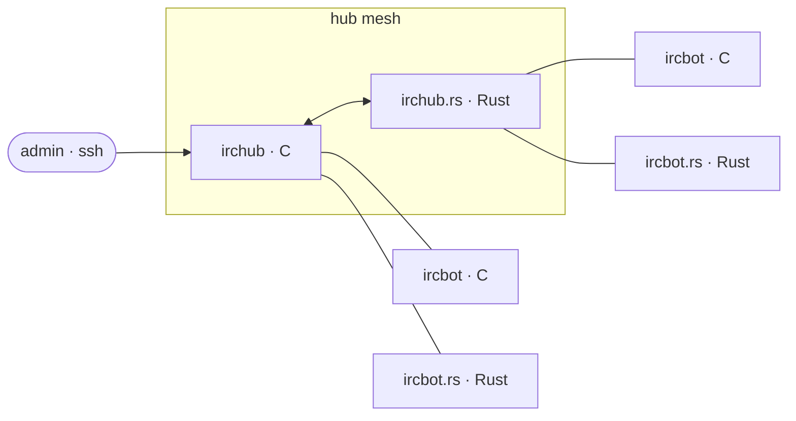

# irchub.rs

A hub server for networks of IRC bots, in safe Rust (`#![forbid(unsafe_code)]`), a 1:1 port of [irchub](https://github.com/robertclemens/irchub). It registers bots, pushes each one its encrypted configuration (channels, admins, opers, the other bots' keys), links with other hubs into a mesh, coordinates ops and rolling upgrades, and serves an SSH admin console.

There are no admin, oper or bot passwords. Every hub, bot, admin and oper has its own keypair (Ed25519 signatures, X25519 encryption) and only public keys are exchanged. The one password left is the hub's config-file password.

## The family

Four interchangeable programs. Any bot works with any hub, and C and Rust hubs peer in one mesh.

| Project | Language | Role |
|---------|----------|------|
| [ircbot](https://github.com/robertclemens/ircbot) | C | IRC bot |
| [ircbot.rs](https://github.com/robertclemens/ircbot.rs) | Rust (no `unsafe`) | IRC bot, a 1:1 port of ircbot |
| [irchub](https://github.com/robertclemens/irchub) | C | Hub: config sync, mesh, SSH admin console |
| **[irchub.rs](https://github.com/robertclemens/irchub.rs)** | Rust (no `unsafe`) | Hub, a 1:1 port of irchub |



| | irchub (C) | irchub.rs (Rust) |
|---|:---:|:---:|
| **ircbot (C)** | ✅ | ✅ |
| **ircbot.rs (Rust)** | ✅ | ✅ |
| **peer hub: irchub / irchub.rs** | ✅ | ✅ |

Same wire protocol, same config files, same console. All four share version numbers. Use matching releases: a hub refuses bots and peers below its version floor.

## Demo

Three short recordings, each also as screenshots with every command ([all walkthroughs](demo/README.md)):

1. **[Set up two hubs, link them, add a bot](demo/setup.md)**
2. **[The hub console over SSH](demo/console.md)**: login, sample commands, full-screen view
3. **[Commanding a bot from irssi](demo/irssi.md)**

[](demo/setup.md)

## Requirements

- Rust 1.89+ (`cargo`, `rustc`): [rustup](https://rustup.rs), or your distribution's `cargo` if it is new enough
- A C compiler (`cc`): `ring`, the SSH console's crypto backend, compiles a little C and assembly
- No OpenSSL, libcurl or make. The hub's crypto is RustCrypto and dalek. The SSH console is [russh](https://crates.io/crates/russh) on a single-threaded tokio runtime

## Quick reference

```bash
# Build
git clone https://github.com/robertclemens/irchub.rs.git && cd irchub.rs
cargo build --release       # target/release/irchub, target/release/keygen

# The admin makes a keypair on their own machine (IRC key + SSH key, optional passphrase)
target/release/keygen admin            # → <ts>_admin.public.b64, <ts>_admin.private.b64, <ts>_admin_ed25519

# One directory per hub; config, pid and log live beside the binary
mkdir ~/hub1 && cp target/release/irchub ~/hub1/ && cd ~/hub1
./irchub -setup             # port, bind IP, name, password, first admin (their .public.b64 + usermask)
./irchub -p                 # optional: machine-bound .irchub.pass for unattended start
./irchub                    # start (daemonizes; asks for the password if there is no .irchub.pass)
./irchub -id                # uuid, public key, SSH host key, ready `hub add` and `+hub` lines
kill $(cat .irchub.pid)     # stop

# Admin console: an SSH server on the hub's own port (check the host key against -id)
ssh -i <ts>_admin_ed25519 -o IdentitiesOnly=yes -p 8001 admin@hub1.example.net

# In the console (help lists everything)
hub add <ip> <port> <uuid> <name> <pubkey>     # link a hub (from its -id); do it on both hubs,
                                               # the link comes up on the next dial (up to 2 min)
bot add <nick> <uuid> <pubkey>                 # register a bot (from its ircbot -id)
channel add #demo                              # every bot joins
user add admin|oper <name> <pubkey> <mask> …   # more admins and opers

# Optional keepalive, needs .irchub.pass:  */5 * * * * /home/user/hub1/irchub
```

## Setup

1. **Admin key.** The first admin runs `keygen <name>` on their own machine. The private files stay there. The hub only gets the `.public.b64`.
2. **Hub.** `./irchub -setup` in the hub's directory. It makes the hub's own keypair (the private key lives only inside the encrypted config), registers the first admin and exits. `./irchub` starts it.
3. **Console.** `ssh -i <ts>_<name>_ed25519 -p <port> <name>@<hub>`. On first login, compare the host key with `./irchub -id` or `keygen --ssh-fingerprint hub_public.b64`. Only admins log in. `TERM=dumb` gives a plain line mode for scripts.
4. **More hubs.** Set each one up the same way, then `hub add` each hub on the other.
5. **Bots.** On the bot's machine, `ircbot -setup` (hub-managed) asks for each hub's address and public key, and prints the bot's UUID and key. Then run `bot add` in the console. The bot gets everything else from the hub. Hub-managed is the recommended way to run bots.

Admin flags: `+a` is a full admin. Otherwise pick letters: `b` bots, `c` channels, `h` hub, `o` opers, `u` upgrades. Opers are bound to `*` or a channel list. `option set h` limits all user, mask, key and channel changes to the hub console.

## Commanding bots from IRC

Admins and opers sign in to a bot with their `.private.b64`, using the client scripts in [ircbot.rs's `utils/`](https://github.com/robertclemens/ircbot.rs/tree/main/utils) (irssi, HexChat, WeeChat, command line, mIRC). irssi (the [irssi walkthrough](demo/irssi.md) shows a real session):

```
/script load ircbot_irssi_auth.pl          (copied into ~/.irssi/scripts/)
/set bot_auth_keyfile /home/user/admin/20261121120000_admin.private.b64
/botcmd bot1 status                        asks for the key's passphrase, signs in, shows the bot key's fingerprint
```

## Security

- Bot↔hub and hub↔hub traffic is AES-256-GCM with keys from X25519. Peers and bots authenticate with Ed25519.
- No private key ever crosses the network. The hub never holds a bot's or an admin's private key.
- `.irchub.cnf` is AES-256-GCM, keyed by PBKDF2-SHA256 at 600k rounds. `.irchub.pass` is bound to the machine and user (0600).
- Per-IP connection limits and failed-auth blocking (`hub set conn …`), and allow/deny lists (`acl …`).
- Key material is wiped from memory after use. The console log ring is `mlock`ed and kept out of core dumps.

## Files

| File | |
|------|---|
| `.irchub.cnf` | config, encrypted (from `-setup`) |
| `.irchub.pass` | optional machine-bound password file, 0600 (from `-p`) |
| `hub_public.b64` | this hub's public key as of `-setup` (`-id` always shows the current one) |
| `.irchub.pid`, `.irchub.log` | pid file, log (off by default: `log set file <level>`) |

## License

MIT — see [LICENSE](LICENSE).
