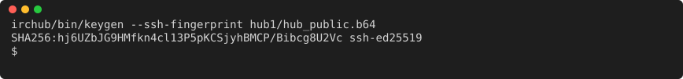
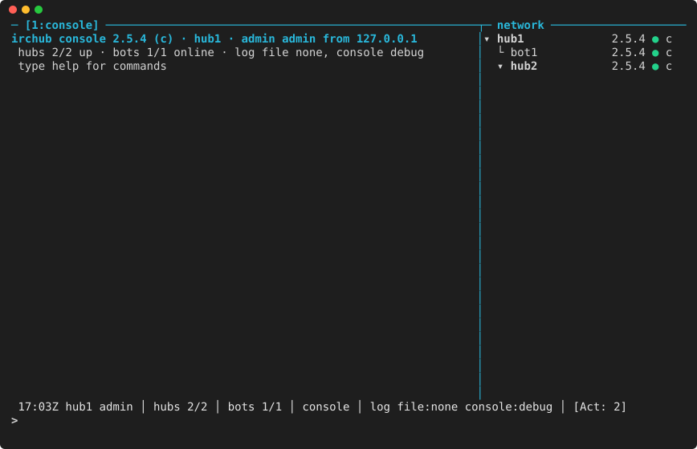
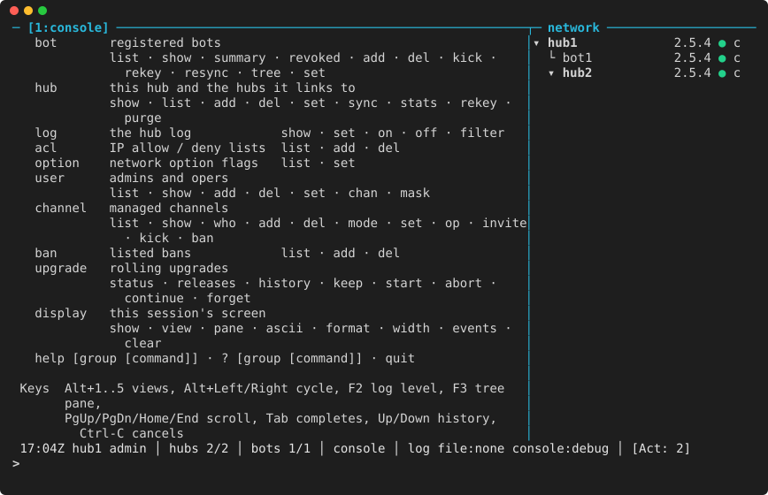
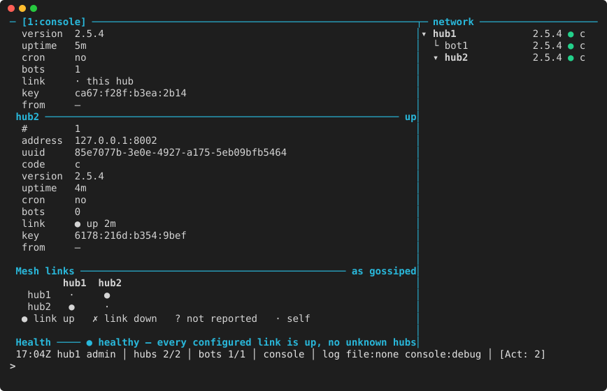
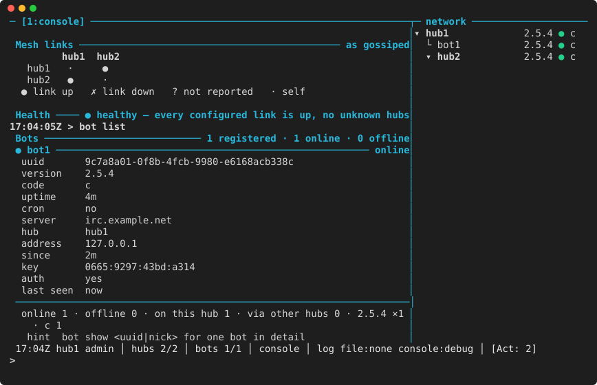
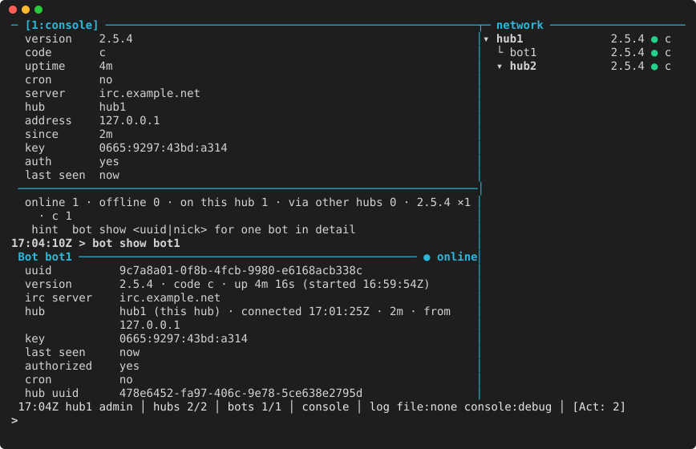
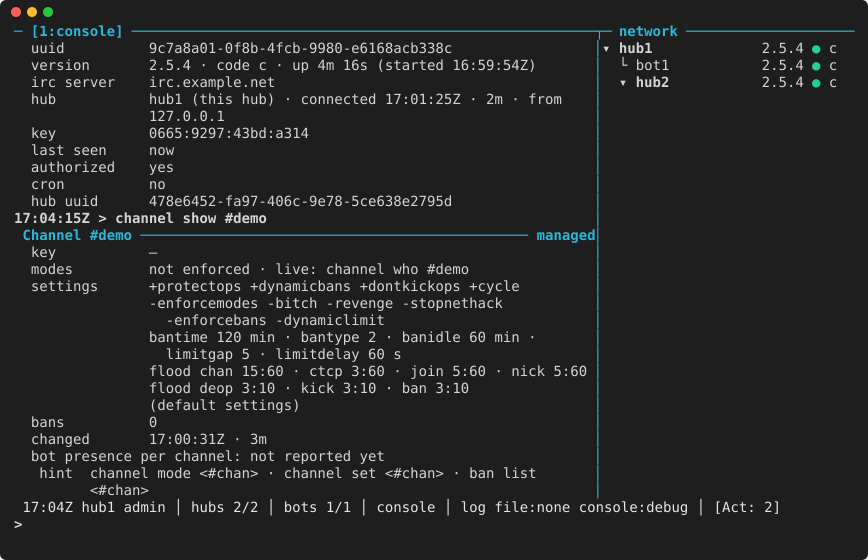
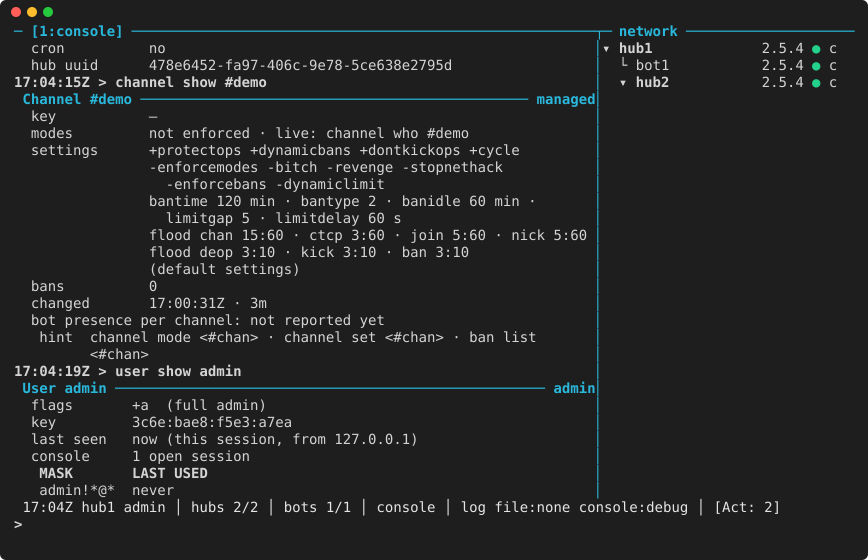
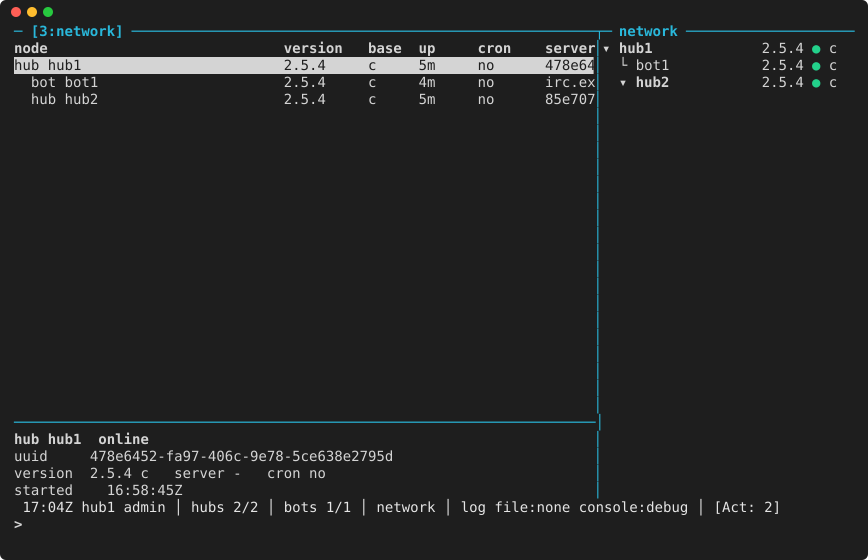

# The hub console over SSH

Each hub serves an SSH console on its own port. Only admins log in, with the SSH key `keygen` made. There is no password and no system account.


The same steps as screenshots:

## 1. Check the hub's SSH host key

Compare this fingerprint with the one ssh shows on the first login.

```
irchub/bin/keygen --ssh-fingerprint hub1/hub_public.b64
```



## 2. Log in with the admin's SSH key

Any SSH client works (OpenSSH, PuTTY, phone apps). The console has an output pane, a live network tree, a status bar and the input line. Scripts can use `TERM=dumb ssh -tt …` for a plain line mode with one `[ok #N]` / `[err #N]` per command.

```
ssh -i admin/20261122105812_admin_ed25519 -o IdentitiesOnly=yes -p 8001 admin@127.0.0.1
```



## 3. Help

`help <group>` lists a group's commands; `help <group> <command>` explains one.

```
> help
```



## 4. Hub list

```
> hub list
```



## 5. Bot list

```
> bot list
```



## 6. Bot show bot1

```
> bot show bot1
```



## 7. Channel show #demo

```
> channel show #demo
```



## 8. User show admin

```
> user show admin
```



## 9. Views: Alt+1 … Alt+5

`Alt+1` console, `Alt+2` raw log, `Alt+3` network, `Alt+4` upgrades, `Alt+5` stats.

```
Alt+3
> quit
```



← [Set up two hubs, link them, add a bot](setup.md) · [all walkthroughs](README.md) · [Commanding a bot from irssi](irssi.md) →
