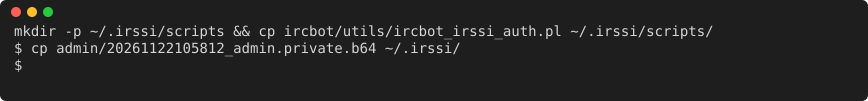
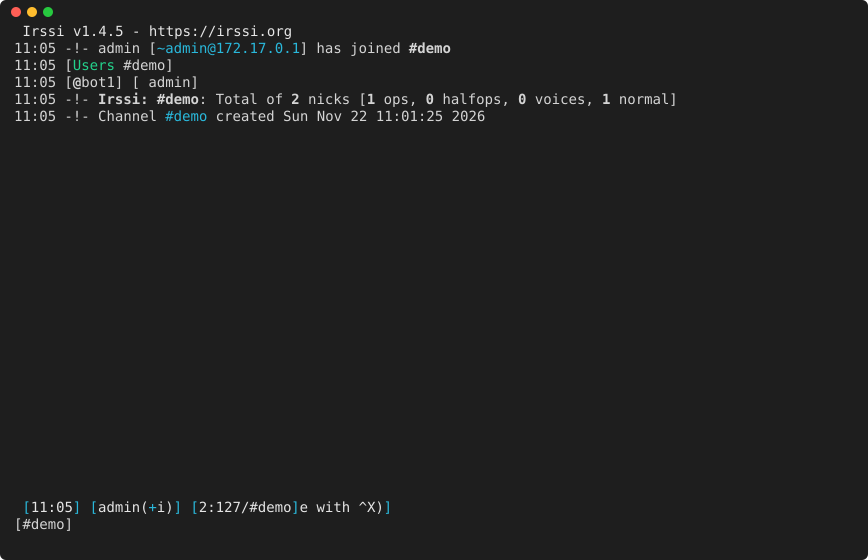
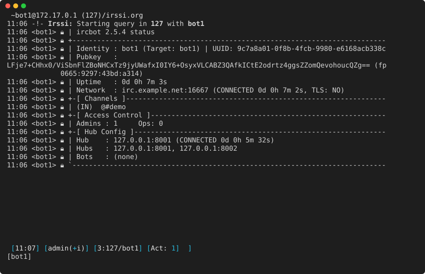
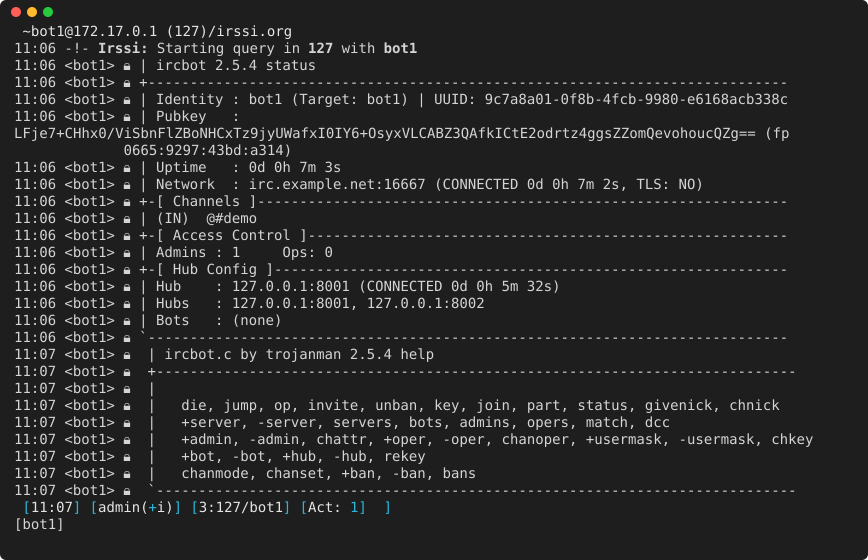
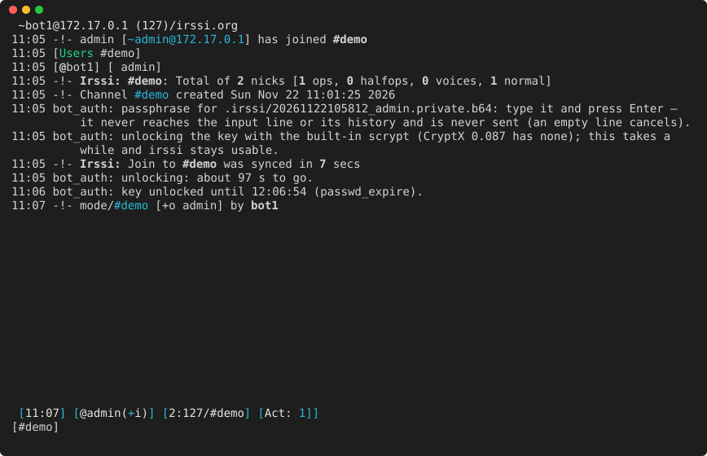

# Commanding a bot from irssi

Admins and opers command bots on IRC with their own `.private.b64`. The irssi script signs in to the bot and seals every command. HexChat, WeeChat, mIRC and command-line versions are in ircbot's `utils/` (see `utils/README.txt` there).


The same steps as screenshots:

## 1. Install the script and the admin's key

irssi only needs the script and the admin's `.private.b64`. In this demo the key sits in `~/.irssi`; anywhere irssi can read it works.

```
mkdir -p ~/.irssi/scripts && cp ircbot/utils/ircbot_irssi_auth.pl ~/.irssi/scripts/
cp admin/20261122105812_admin.private.b64 ~/.irssi/
```



## 2. Start irssi, load the script, point it at the key

`bot_auth_keyfile` takes the path to the `.private.b64` (a full path in practice; `~` is not expanded).

```
irssi -c 127.0.0.1 -p 16667 -n admin
/script load ircbot_irssi_auth.pl
/set bot_auth_keyfile .irssi/20261122105812_admin.private.b64
/join #demo
```



## 3. The first command signs in

The first command asks for the key's passphrase in irssi's input line, signs in to the bot and shows the bot key's fingerprint. Compare it once with the hub's `bot list`. Replies are sealed to you and shown with a lock. With CryptX older than 0.088 (no native scrypt) the first unlock takes a minute or two; the key then stays unlocked for `bot_auth_passwd_expire` (default 1 h).

```
/botcmd bot1 status
/query bot1
```



## 4. More commands

Replies arrive in the bot's query window (`/query bot1`). `help <command>` explains one.

```
/botcmd bot1 help
```



## 5. Ops on #demo

`op`, `invite`, `unban` and `key` work for admins and for opers on their channels.

```
/window 2
/botcmd bot1 op #demo
/quit
```



← [The hub console over SSH](console.md) · [all walkthroughs](README.md)
