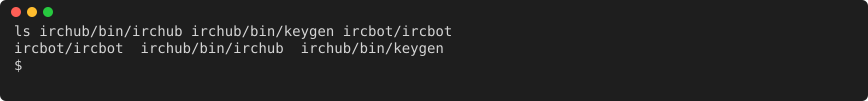
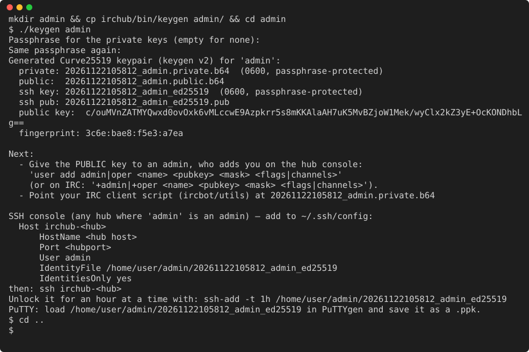
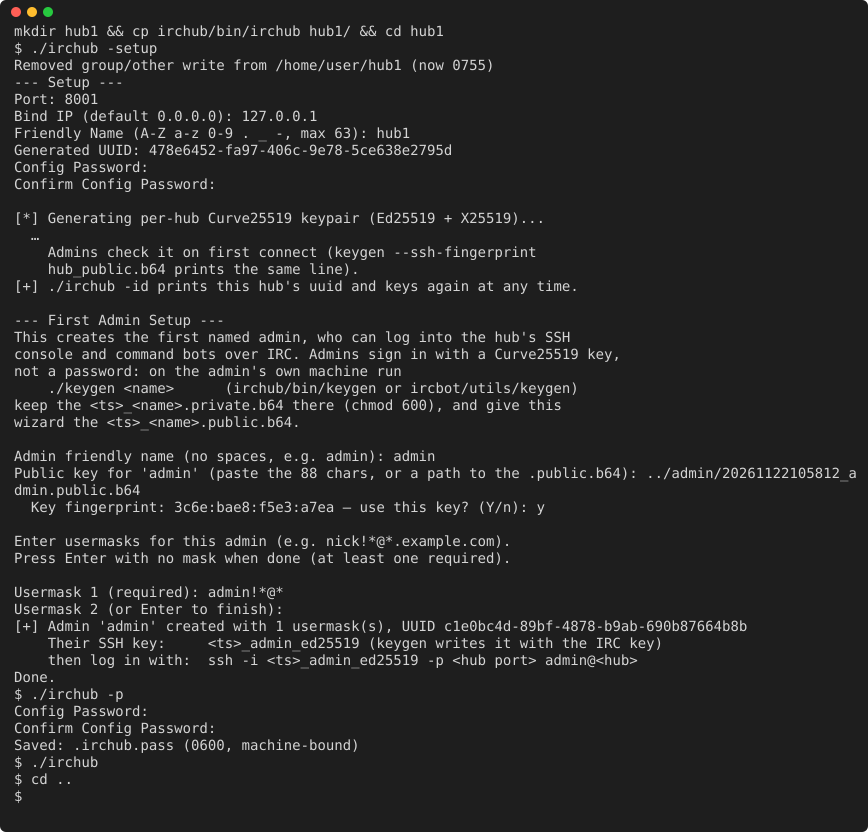
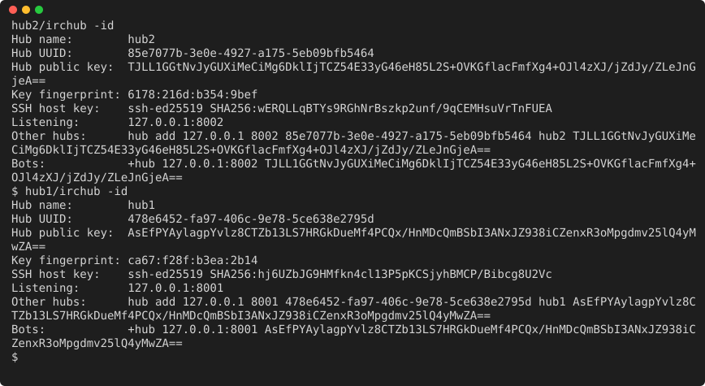
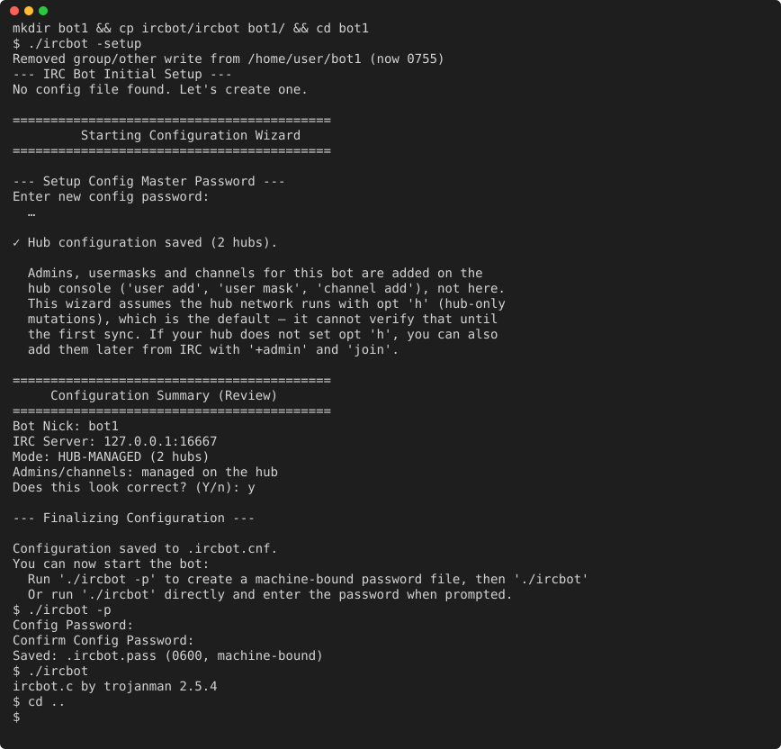
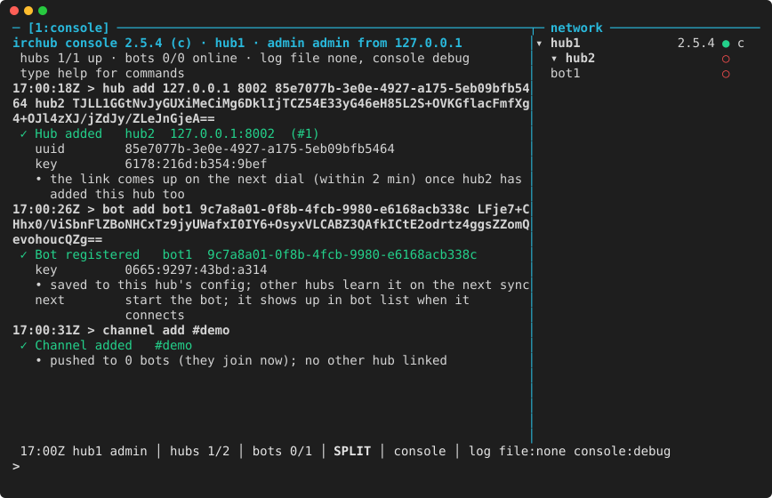
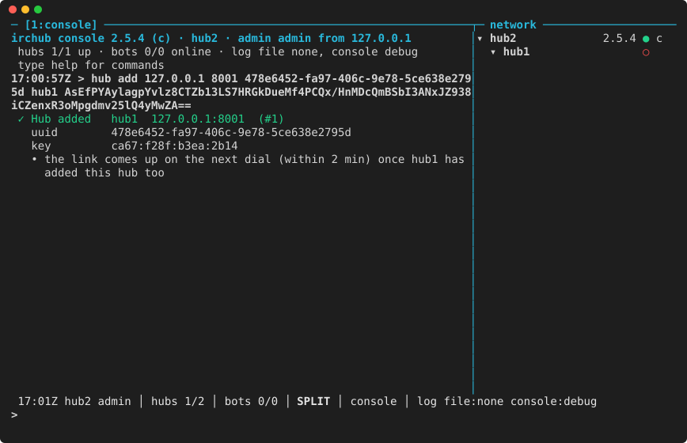
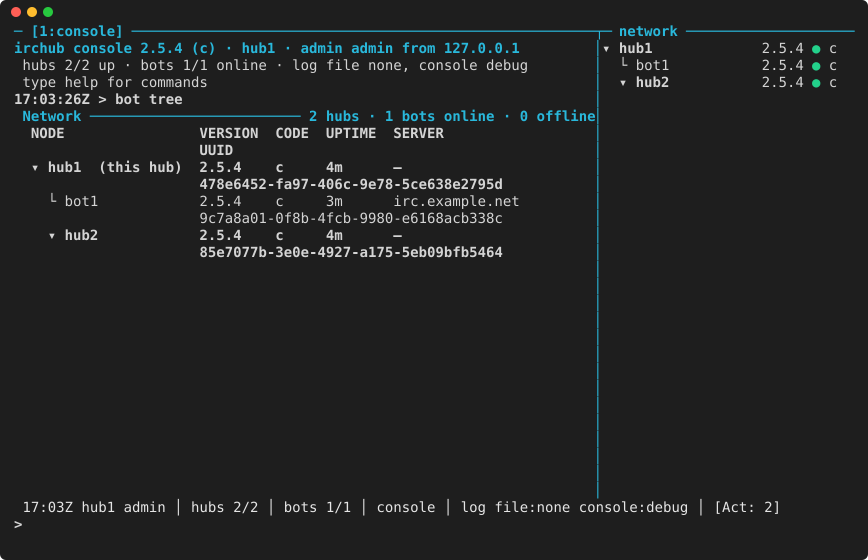

# Set up two hubs, link them, add a bot

Two hubs, linked, with one bot and one admin, from binaries already built from GitHub main. **Hub-managed bots are the recommended setup.**


The same steps as screenshots:

## Starting point

Both trees are already built. Each README's Quick reference has the build commands. The commands are the same for C and Rust; only the binary paths differ (see the table on the [index](README.md)).

```
ls irchub/bin/irchub irchub/bin/keygen ircbot/ircbot
```



## 1. The admin makes a keypair (IRC key + SSH key) on their own machine

Each admin makes their own keypair on their own machine. `keygen` writes the IRC key (`.private.b64`, for the IRC scripts), the SSH key (`_ed25519`, for the hub console) and their public halves. A passphrase is optional but recommended. Only the `.public.b64` is ever given to a hub.

```
mkdir admin && cp irchub/bin/keygen admin/ && cd admin
./keygen admin
cd ..
```



## 2. Hub1: setup wizard, password file for unattended start, start it

`-setup` asks for the port, bind address, name, config password and the first admin (their `.public.b64` and a usermask). It makes the hub's own keypair, which never leaves the encrypted config. `-p` writes a machine-bound password file so the hub can start unattended. `./irchub` daemonizes.

```
mkdir hub1 && cp irchub/bin/irchub hub1/ && cd hub1
./irchub -setup
./irchub -p
./irchub
cd ..
```



## 3. Hub2: the same, on its own port

A second hub, set up the same way.

```
mkdir hub2 && cp irchub/bin/irchub hub2/ && cd hub2
./irchub -setup
./irchub -p
./irchub
cd ..
```


## 4. Print each hub's identity: uuid, key and ready 'hub add' / '+hub' lines

`-id` prints what others need: the `hub add` line for other hubs, and the `+hub` address and key for bots.

```
hub2/irchub -id
hub1/irchub -id
```



## 5. Bot1: setup wizard (hub-managed, both hubs), password file, start

Hub-managed mode: the bot only needs each hub's address and public key, and gets admins, opers and channels from the hub. The wizard prints the bot's UUID and public key for `bot add`.

```
mkdir bot1 && cp ircbot/ircbot bot1/ && cd bot1
./ircbot -setup
./ircbot -p
./ircbot
cd ..
```



## 6. On hub1's console: link hub2, register bot1, add a channel

Log in to hub1's console (the [console walkthrough](console.md) covers login), then link hub2, register bot1 and add a channel. Every bot joins it.

```
ssh -i admin/20261122105812_admin_ed25519 -o IdentitiesOnly=yes -p 8001 admin@127.0.0.1
> hub add 127.0.0.1 8002 85e7077b-3e0e-4927-a175-5eb09bfb5464 hub2 TJLL1GGtNvJyGUXiMeCiMg6DklIjTCZ54E33yG46eH85L2S+OVKGflacFmfXg4+OJl4zXJ/jZdJy/ZLeJnGjeA==
> bot add bot1 9c7a8a01-0f8b-4fcb-9980-e6168acb338c LFje7+CHhx0/ViSbnFlZBoNHCxTz9jyUWafxI0IY6+OsyxVLCABZ3QAfkICtE2odrtz4ggsZZomQevohoucQZg==
> channel add #demo
> quit
```



## 7. On hub2's console, link back to hub1

Each hub must add the other.

```
ssh -i admin/20261122105812_admin_ed25519 -o IdentitiesOnly=yes -p 8002 admin@127.0.0.1
> hub add 127.0.0.1 8001 478e6452-fa97-406c-9e78-5ce638e2795d hub1 AsEfPYAylagpYvlz8CTZb13LS7HRGkDueMf4PCQx/HnMDcQmBSbI3ANxJZ938iCZenxR3oMpgdmv25lQ4yMwZA==
> quit
```



## 8. The link comes up on the hubs' next dial (up to 2 min); bot tree shows the mesh

The new link comes up on the hubs' next dial, which can take up to two minutes. `bot tree` then shows both hubs and bot1.

```
ssh -i admin/20261122105812_admin_ed25519 -o IdentitiesOnly=yes -p 8001 admin@127.0.0.1
> bot tree
> quit
```



[all walkthroughs](README.md) · [The hub console over SSH](console.md) →
